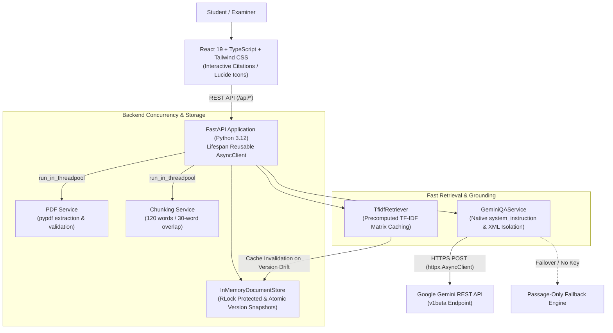

# DocuMind AI — Document Q&A Learning Workspace

DocuMind AI is a retrieval-augmented document question-answering workspace built with FastAPI and React 19. It allows students and researchers to upload PDF documents, extract and chunk text with page-level attribution, search relevant passages using precomputed TF-IDF vector similarity, and receive grounded answers supported by interactive citations.

---

## 1. System Architecture



### Core Grounding Invariants
- **Exact Citations**: Answers cite source documents and page numbers (e.g. `[sample_rag_primer.pdf, p. 1]`). Clicking citation badges in the UI scrolls to and highlights the corresponding passage excerpt.
- **Strict Negative Grounding**: If the document does not contain sufficient facts to answer the question, the system strictly returns:
  > `The document does not contain this information.`
- **Resilient Fallback**: If Gemini is offline, unkeyed, or rate-limited, DocuMind AI returns retrieved passages with an explicit `[Passage-only fallback]` notice.
- **Prompt Injection Defense**: Passages are wrapped in XML tags (`<documents><passage ...>`) with character escaping (`escape` + `quoteattr`), and system rules are delivered via privileged `system_instruction`.

---

## 2. Prerequisites

- **Operating System**: macOS, Linux, or Windows (WSL2 recommended)
- **Python**: 3.12+
- **Node.js**: v20+ (Verified on Node.js v26.12.1 and npm 11.20.0)

---

## 3. Environment Variables Configuration

Create a `.env` file from the example template:

```bash
cp .env.example .env
```

Configure `.env` as needed:

```env
# Server Binding
HOST=127.0.0.1
PORT=8000

# Document Ingestion Settings
MAX_FILE_SIZE_BYTES=10485760   # 10 MB maximum
TARGET_CHUNK_WORDS=120
CHUNK_OVERLAP_WORDS=30
DEFAULT_TOP_K=4

# Google Gemini API
GEMINI_API_KEY=your_gemini_api_key_here
GEMINI_MODEL=gemini-3.5-flash-lite
GEMINI_TIMEOUT_SECONDS=30.0
```

> [!IMPORTANT]
> Never commit `.env` or expose API keys. If `GEMINI_API_KEY` is omitted or left as a placeholder, the system activates passage-only fallback mode without crashing.

---

## 4. One-Command Startup

DocuMind AI includes an executable launcher script that validates the environment, builds the frontend bundle if needed, and starts the server:

```bash
# Make script executable (first time only)
chmod +x run.sh

# Run production application
./run.sh
```

Open **`http://127.0.0.1:8000`** in your browser.

### Development Mode (Hot-Reload)
To develop with live hot-reloading across both backend and frontend:

```bash
./run.sh --dev
```
- **Backend API**: `http://127.0.0.1:8000` (auto-reloads on Python file edits)
- **Vite Dev Server**: `http://localhost:5173` (hot module replacement)

---

## 5. REST API Endpoints Specification

| Method | Endpoint | Request Body | Response | Description |
| :--- | :--- | :--- | :--- | :--- |
| `GET` | `/api/health` | _None_ | `{"status": "ok", "documents_count": int, "chunks_count": int}` | Health check and corpus metrics. |
| `POST` | `/api/documents/upload` | `multipart/form-data` (`file: PDF`) | `DocumentMeta` JSON | Ingests PDF (max 10 MB), validates text, chunks pages. |
| `GET` | `/api/documents` | _None_ | `{"documents": [...], "total": int}` | Lists all documents currently stored in memory. |
| `DELETE`| `/api/documents/{doc_id}` | _None_ | `{"message": str, "doc_id": str}` | Deletes document and chunks; invalidates retrieval cache. |
| `POST` | `/api/documents/search` | `{"query": str, "doc_id"?: str, "top_k"?: int}` | `{"query": str, "results": [...], "total_results": int}` | Searches chunks using precomputed TF-IDF index. |
| `POST` | `/api/documents/ask` | `{"question": str, "doc_id"?: str, "top_k"?: int}` | `{"question": str, "answer": str, "sources": [...], ...}` | Generates grounded answer with source citations. |
| `GET` | `/` | _None_ | `text/html` | Serves React production SPA (or fallback `app/static/`). |

---

## 6. Verification and Automated Testing

### Backend Unit & Integration Tests (108 Tests)
Run the automated test suite:

```bash
.venv/bin/pytest tests/ -v
```

All 108 tests verify:
- **PDF Extraction**: Magic byte validation, 10 MB cap, blank PDF rejection, corrupt stream handling.
- **Chunking**: Target word counts, 30-word overlap, multi-page boundary attribution.
- **Thread-Safe Storage**: `threading.RLock()` protection under 60 concurrent worker threads.
- **Precomputed TF-IDF Retrieval**: Version-based cache invalidation, acronym expansion, and tie-breaking.
- **Prompt Security**: XML escaping (`escape` + `quoteattr`), `system_instruction` formatting, and prompt-injection resilience.
- **FastAPI Lifespan**: Reusable `httpx.AsyncClient` connection pooling and shutdown cleanup.

### End-to-End Workflow & Headless Chrome Verification
Execute the automated end-to-end journey:

```bash
.venv/bin/python scripts/verify_e2e.py
```

This verifies:
1. Health check initialization.
2. Canonical PDF upload (`demo/sample_rag_primer.pdf`).
3. Document listing and chunk attribution.
4. TF-IDF retrieval scoring.
5. Grounded Q&A with citations.
6. Unsupported question abstention (`The document does not contain this information.`).
7. Fallback activation when Gemini is unconfigured.
8. Document deletion and store cleanup.
9. Headless Google Chrome DOM inspection (Desktop 1280x800 and Mobile 375x667).

---

## 7. Repeatable Three-Minute Demonstration Workflow

Follow this scripted walkthrough during your project demonstration using the canonical sample document:

```bash
# Ensure sample PDF exists
python demo/generate_sample_pdf.py

# Launch the platform
./run.sh
```

1. **Launch**:
   Navigate to `http://127.0.0.1:8000`. Point out the **DocuMind AI** navigation header, the **In-Memory Session** indicator, and the empty document library.
2. **Upload Canonical Sample PDF**:
   - Drag and drop `demo/sample_rag_primer.pdf` (3 pages) into the upload zone.
   - Point out the upload progress bar followed by chunking.
   - Highlight the created card: **3 pages**, **4 chunks**, **~4.5 KB**.
3. **Ask a Grounded Question (Page 1 Grounding)**:
   - Query: *"What is Retrieval-Augmented Generation and how does chunking work?"*
   - Point out the synthesized answer. Click the interactive citation badge `[sample_rag_primer.pdf, p. 1]`.
   - Observe the smooth scroll and highlight ring on the corresponding citation card.
   - Click **View passage** to show the exact source evidence.
   - Click **Copy** to demonstrate one-click citation copying.
4. **Ask an Acronym & Retrieval Question (Page 2 Grounding)**:
   - Query: *"How does TF-IDF calculate similarity scores?"*
   - Show that the answer cites `p. 2` with cosine similarity explanation.
5. **Demonstrate Unsupported Question Abstention**:
   - Query: *"What is the recipe for baking chocolate chip cookies?"*
   - Point out the exact honest abstention returned:
     > `The document does not contain this information.`
6. **Demonstrate Resilience**:
   - Explain that if Gemini API keys are omitted or network limits occur, the platform activates **Passage-Only Fallback** with retrieved excerpts rather than failing.
7. **Clean Library Reset**:
   - Click the trash icon on the document card to delete it. Show that health metrics reset to 0 documents.

---

## 8. Troubleshooting Guide

| Issue | Cause | Solution |
| :--- | :--- | :--- |
| **`Error: Port 8000 is already in use`** | Another process is listening on port 8000. | Check running processes with `lsof -i :8000` or configure a different port in `.env` (e.g. `PORT=8080`). |
| **`Frontend index.html not found`** | The React bundle has not been built yet. | Run `npm run build --prefix frontend` or use `./run.sh` which builds it automatically. |
| **`Gemini API key is not configured`** | `GEMINI_API_KEY` is not present in `.env`. | This is normal for offline testing; DocuMind operates in passage-only fallback mode. To enable AI synthesis, set a valid key in `.env`. |
| **`File exceeds maximum allowed limit`** | Uploaded file exceeds 10 MB. | Ensure PDFs are under 10 MB or adjust `MAX_FILE_SIZE_BYTES` in `.env`. |

---

## 9. Known Limitations

- **In-Memory Volatility**: Document chunks and indices reside in server RAM for this demo. Restarting the backend process clears uploaded files.
- **Single-User Workspace**: Designed as an educational prototype; does not currently include multi-tenant user authentication or relational databases.
- **Fallback Interface**: If `frontend/dist/` is removed, FastAPI automatically serves the original vanilla HTML/CSS fallback from `app/static/`.
