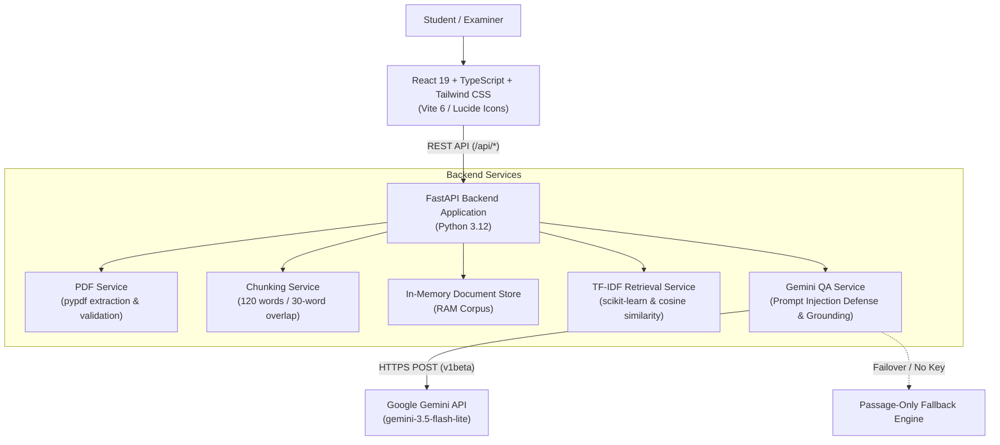

# DocuMind AI — Document Q&A Learning Workspace

DocuMind AI is a student-built, retrieval-augmented question answering workspace. It allows learners to upload PDF course readings, extract and chunk text with page-level attribution, search relevant passages using TF-IDF and cosine similarity, and receive grounded answers supported by exact source citations.

---

## 1. System Architecture



### Invariant Grounding Rules
- **Strict Citation**: Answers cite exact page numbers and filenames (e.g. `[syllabus.pdf, p. 1]`).
- **Unsupported Questions**: If the document lacks evidence, the system strictly returns:
  > `The document does not contain this information.`
- **Honest Fallback**: If the Gemini service is unavailable or unkeyed, the app returns retrieved passages with an explicit `[Passage-only fallback]` notice.

---

## 2. Prerequisites & Environment Setup

- **Operating System**: macOS, Linux, or Windows (WSL2 recommended)
- **Python**: 3.12+
- **Node.js**: v20+ (Verified on Node.js v26.12.1 and npm 11.20.0)

### Clone & Enter Directory
```bash
cd /path/to/documind-ai
```

---

## 3. Environment Variables Configuration

Create a `.env` file from the example template:

```bash
cp .env.example .env
```

Edit `.env` with your preferred configuration:

```env
# Server Binding
HOST=127.0.0.1
PORT=8000

# Document Ingestion Settings
MAX_FILE_SIZE_BYTES=10485760   # 10 MB maximum
TARGET_CHUNK_WORDS=120
CHUNK_OVERLAP_WORDS=30
DEFAULT_TOP_K=4

# Google Gemini API
GEMINI_API_KEY=your_gemini_api_key_here
GEMINI_MODEL=gemini-3.5-flash-lite
GEMINI_TIMEOUT_SECONDS=30.0
```

> [!IMPORTANT]
> Never commit `.env` or expose API keys. The `.gitignore` is pre-configured to keep secrets out of version control. If `GEMINI_API_KEY` is omitted or left as placeholder, the system gracefully activates passage-only fallback mode.

---

## 4. Backend Setup

Set up a virtual environment and install backend dependencies:

```bash
# Create virtual environment
python3.12 -m venv .venv

# Activate virtual environment
source .venv/bin/activate  # On Windows: .venv\Scripts\activate

# Install dependencies
pip install -r requirements.txt
```

---

## 5. Frontend Setup & Build

The modern React frontend lives in `frontend/`. Install dependencies:

```bash
cd frontend
npm install
```

### Build for Production (Option A — Recommended)
```bash
npm run build
```
This compiles the TypeScript code and Tailwind styles into `frontend/dist/`. FastAPI is configured to automatically serve this production bundle when `GET /` is requested.

---

## 6. Running the Application

### Production Mode (Single Process)
Build the frontend once, then start FastAPI:

```bash
# 1. Build React frontend (from repository root)
cd frontend && npm run build && cd ..

# 2. Start FastAPI server
.venv/bin/uvicorn app.main:app --host 127.0.0.1 --port 8000
```
Open **`http://127.0.0.1:8000`** in your browser. FastAPI serves the compiled React application directly.

### Development Mode (Hot-Reload)
Run both processes in separate terminal windows:

**Terminal 1 — FastAPI Backend**:
```bash
.venv/bin/uvicorn app.main:app --host 127.0.0.1 --port 8000 --reload
```

**Terminal 2 — Vite Dev Server**:
```bash
cd frontend && npm run dev
```
Open **`http://127.0.0.1:5173`**. The Vite server proxies all `/api/*` calls directly to the FastAPI backend on port 8000.

---

## 7. Running the Test Suite

Run the full automated pytest suite (96 unit and integration tests):

```bash
.venv/bin/pytest tests/ -v
```

All 96 tests cover:
- PDF page extraction, extension checks, 10 MB limit enforcement, and corrupted/empty file rejection.
- Text chunking word counts, 30-word overlaps, and page boundary attribution.
- In-memory document storage CRUD and chunk filtering.
- TF-IDF retrieval scoring, acronym expansion, and tie-breaking.
- Grounded prompt construction and prompt injection defenses.
- Upstream Gemini timeout diagnostics (`ConnectTimeout`, `ReadTimeout`).
- Fallback activation and exact unsupported-answer sentence preservation.
- Static asset serving and production bundle delivery.

---

## 8. Repeatable Two-Minute Examiner Demo

Follow this scripted walkthrough during your project demonstration:

1. **Launch**:
   Start the application and navigate to `http://127.0.0.1:8000`. Point out the **In-Memory Session** header badge and the **Backend: Online** status indicator.
2. **Upload a PDF**:
   - Drag and drop a sample PDF (e.g. 1–5 MB) into the upload area.
   - Observe the **truthful upload byte progress bar** streaming transfer progress, followed by the indeterminate chunking state as the server extracts pages.
   - Point out the resulting document card showing accurate **page count**, **chunk count**, and **file size**.
3. **Inspect Search Scope**:
   - Show the **All Documents** card at the top of the sidebar.
   - Click an individual document to demonstrate scope restriction. Show that the **Active Scope** banner updates immediately.
4. **Ask a Grounded Question**:
   - Click a quick-prompt chip (e.g., *"Summarize the key points"*) or type a specific question about the document.
   - Point out the active searching state, disabled input (preventing double-submission), and the synthesized answer.
   - Highlight the **page citation badge** (e.g., `[report.pdf, p. 2]`) and the cosine similarity score pill.
   - Click **View passage** to expand the exact retrieved text chunk for evidence verification.
5. **Test Unsupported Questions**:
   - Ask an unrelated question (e.g., *"What is the recipe for baking chocolate chip cookies?"*).
   - Show that the system strictly and honestly returns:
     > `The document does not contain this information.`
6. **Explain Fallback Resilience**:
   - Explain that if the network drops or API limits occur, DocuMind AI does not crash; it displays a clearly labeled `Passage-only fallback` badge using the retrieved evidence.
7. **Copy Note & Reset**:
   - Click **Copy Note** to copy the formatted Markdown note with citations.
   - Click **Clear Chat** to reset the conversation log for the next query.

---

## 9. Known Limitations

- **In-Memory Storage**: Documents and chunks reside in server RAM for this demo. Restarting the backend process clears the library.
- **Single-User Workspace**: Designed as a local/student demo; does not include multi-tenant user accounts, OAuth, or durable database persistence.
- **Client-Side File Transfer Tracking**: Upload progress measures client-to-server HTTP byte transmission. Server-side text chunking is executed synchronously upon transfer completion.
- **Fallback Vanilla Interface**: The original vanilla HTML/CSS/JS frontend remains preserved in `app/static/` and is served automatically if `frontend/dist/` is not present.
